# 🏠 ServeHome — Home Services Marketplace (Saudi Arabia)

[](https://github.com/akkhan312/Home-sevices-KSA/actions/workflows/ci.yml)
[](https://github.com/akkhan312/Home-sevices-KSA/actions/workflows/cd.yml)

A bilingual (Arabic / English) marketplace that connects **customers** with **service providers** (AC repair, plumbing, cleaning, electrical …) and gives **admins** full control over payments, payouts and disputes.

Built with **React Native (Expo SDK 54)** for Android, iOS and web, and a **Node.js / Express 5 + Socket.IO** API backed by **Supabase (PostgreSQL)**.

---

## 📱 Screenshots

<sub>Captured from the web build of the app connected to the real API, seeded with demo data (names, bank details and orders are fictional).</sub>

### Customer
<table>
  <tr>
    <td align="center" width="25%">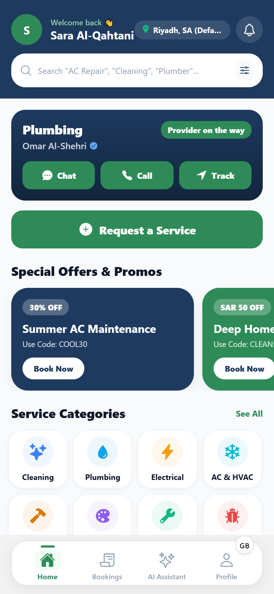<br/><b>Home & active order</b></td>
    <td align="center" width="25%">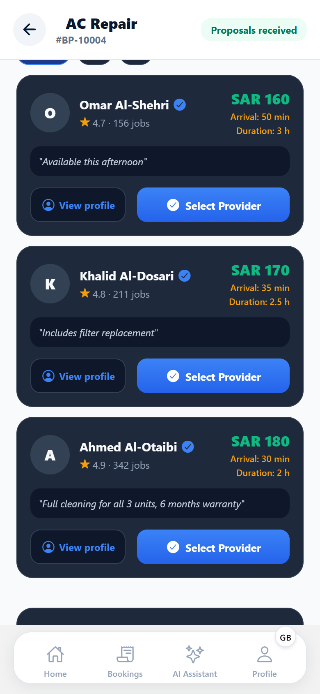<br/><b>Compare proposals</b></td>
    <td align="center" width="25%">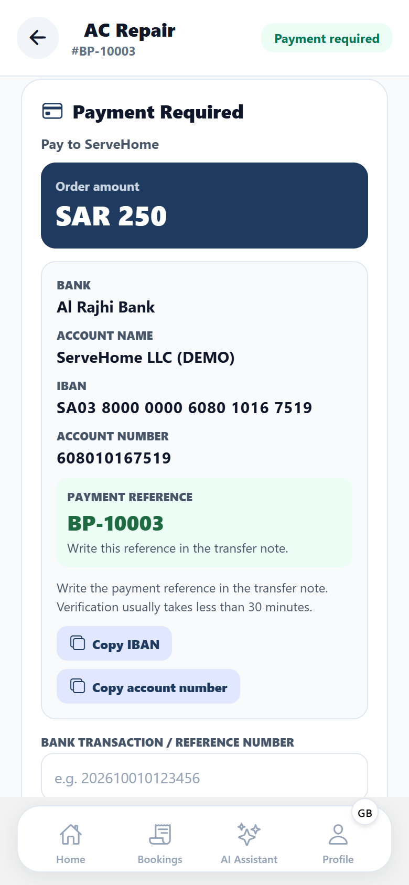<br/><b>Payment required</b></td>
    <td align="center" width="25%">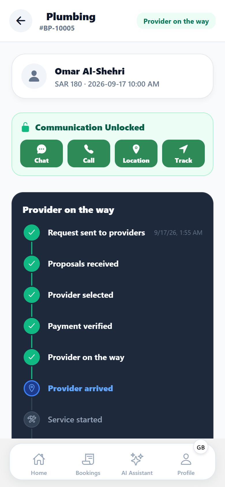<br/><b>Unlocked after payment</b></td>
  </tr>
  <tr>
    <td align="center">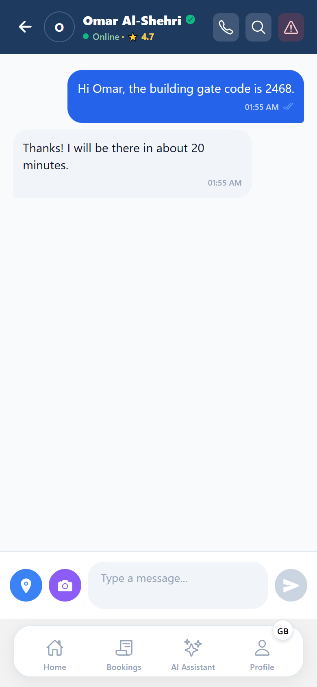<br/><b>Order chat</b></td>
    <td align="center">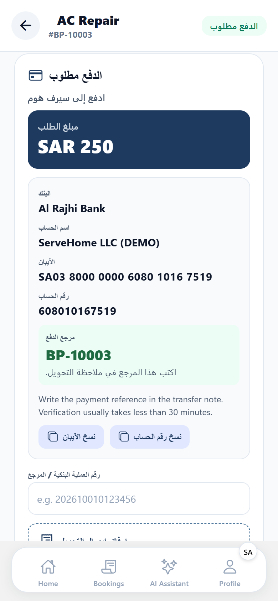<br/><b>العربية</b></td>
    <td align="center"><br/><b>Onboarding</b></td>
    <td align="center">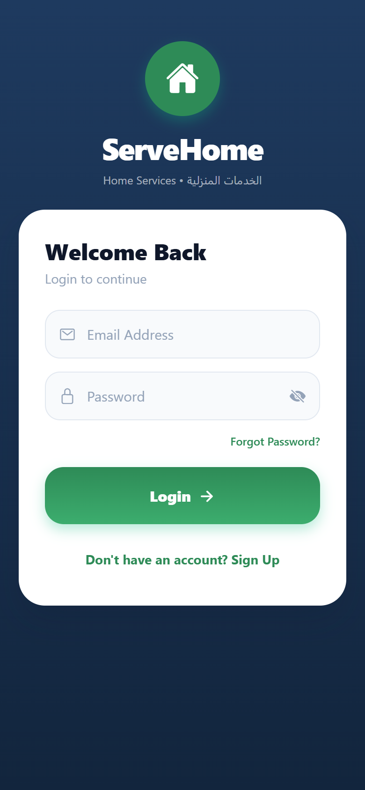<br/><b>Login</b></td>
  </tr>
</table>

### Provider & Admin
<table>
  <tr>
    <td align="center" width="25%">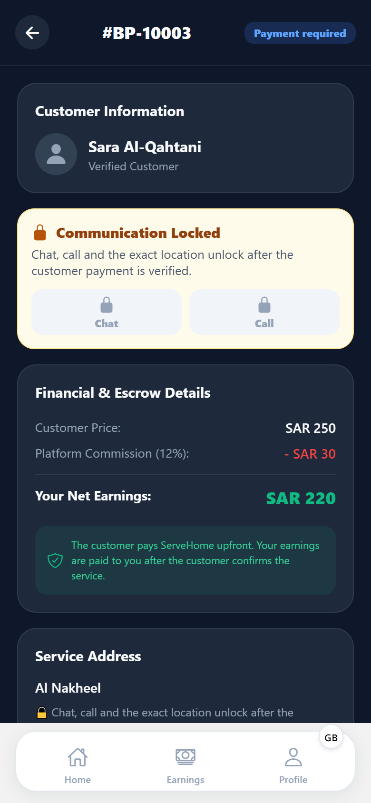<br/><b>Provider: waiting for payment</b></td>
    <td align="center" width="25%">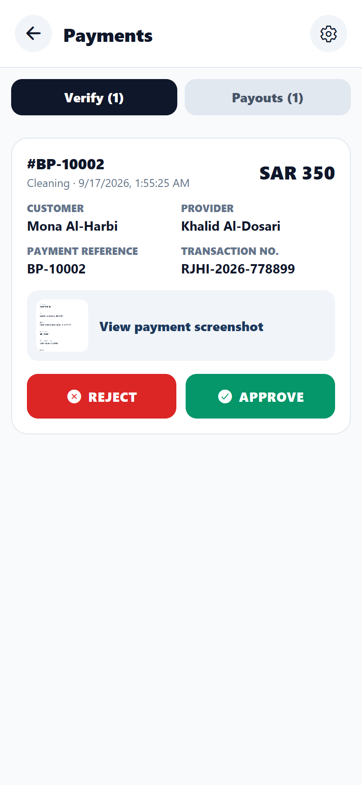<br/><b>Admin: verify payment</b></td>
    <td align="center" width="25%">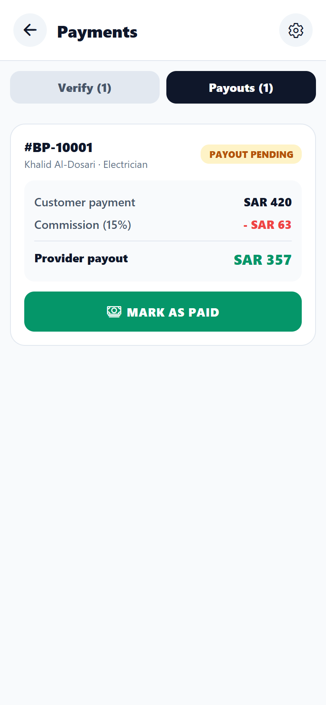<br/><b>Admin: provider payout</b></td>
    <td align="center" width="25%">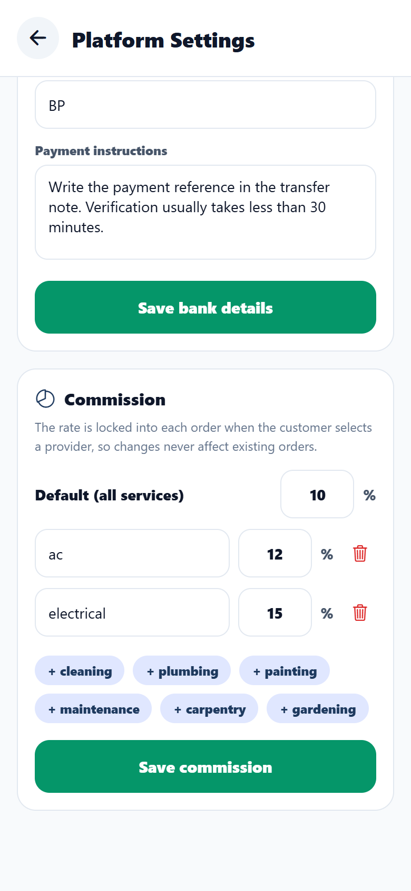<br/><b>Admin: commission rules</b></td>
  </tr>
</table>

---

## ✨ The core flow

```
Customer requests a service
      ↓
Matching providers receive it and send proposals (price · arrival · duration)
      ↓
Customer compares proposals and selects a provider
      ↓
Payment required → customer transfers to the platform bank account and uploads the receipt
      ↓
Admin verifies the payment  ──►  🔓 chat · call · exact location unlock
      ↓
Provider: Start trip (live location) → Arrived → Start service → Complete service
      ↓
Customer confirms (or reports a problem → dispute)
      ↓
Commission is recorded · provider payout becomes pending
      ↓
Admin pays the provider and marks the payout as paid
      ↓
Customer rates the provider (overall, quality, professionalism, punctuality, value)
```

### What makes it safe

| Guarantee | How it is enforced |
|---|---|
| No contact before payment | Chat, calls, live location, exact address and phone are locked **on the server** (REST and every Socket.IO event) until the order is `PAID` **and** `UNLOCKED`. The database itself rejects `UNLOCKED` on an unpaid order. |
| Receipts can't unlock anything | Uploading a receipt only sets `PENDING_VERIFICATION`. Only an admin approval (or a verified Stripe payment) sets `PAID`. |
| Price & commission can't be tampered with | Commission is calculated on the server in halalas (integer maths) from admin-configured rules and **frozen into the order** when the provider is selected. |
| No duplicate money movements | Unique indexes allow one pending receipt, one payout and one ledger entry of each type per order; state changes use conditional updates. |
| Private files stay private | Payment receipts and chat media are served only through short-lived signed URLs. |
| Users only see their own orders | Every order, proposal, chat and call event checks ownership and role. |

---

## 🧩 Features

**Customers** — step-by-step request wizard (service → problem description & up to 4 photos → map pin → date & time → budget), live proposal comparison, provider profiles with category ratings, cancellation of open or unpaid requests, bank-transfer payment with copy buttons and receipt upload, communication lock/unlock, chat (text, photos, voice, location), voice calls, map-based live tracking with distance and arrival estimate, completion confirmation, problem reports, reviews, wallet for refunds with transfer to bank, notifications inbox and push notifications, profile editing, help assistant.

**Providers** — request feed filtered by services, home city + service areas, working days/hours and an online/paused switch; proposals (send, edit, withdraw) and "not interested"; request photos; waiting-for-payment state; trip/arrival/service controls with turn-by-turn navigation; live location sharing that stops automatically; earnings and payout history; payout bank account; admin approval before receiving work.

**Admins** — payment verification with receipt preview (approve / reject with reason), provider payouts showing the provider's bank account (mark as paid with bank reference), disputes (release to provider or refund the customer), wallet transfer requests, bank details & commission settings (global and per category), provider approval, suspension and verification, reports, analytics and an audit log.

The whole app is available in **English and Arabic** (right-to-left layout); `npm run check:i18n` keeps both languages complete.

---

## 🛠️ Tech stack

| Layer | Technology |
|---|---|
| Mobile & web app | React Native 0.81, Expo SDK 54, Expo Router, Zustand, i18next (Arabic RTL / English), react-native-maps, expo-notifications |
| API | Node.js 22, Express 5, Socket.IO 4, Helmet, express-rate-limit, Multer |
| Database & files | Supabase PostgreSQL (row level security enabled, service-role access from the API); uploads on disk or in Supabase Storage |
| Push | Expo push service (FCM on Android, APNs on iOS) |
| Payments | Manual bank transfer with admin verification · optional Stripe PaymentSheet (server-verified + webhook) |
| CI/CD | GitHub Actions: tests, schema validation on PostgreSQL 16, app typecheck/doctor/web build, Docker image to GHCR, optional deploy hook and EAS builds |

---

## 📂 Project structure

```
Home Services/
├── .github/workflows/        CI (every PR/branch) and CD (main)
├── backend/
│   ├── app.js                Express app + Socket.IO (authorization for every event)
│   ├── server.js             Process entry point
│   ├── config.js             Validated environment configuration
│   ├── middleware/           Auth (JWT + live account status), uploads
│   ├── routes/               auth, bookings, chat, admin, reviews, wallets, …
│   ├── services/             access (lock policy), payment, payout, ledger, money, settings, files, …
│   ├── supabase-schema.sql   Complete, idempotent database schema + migration of old data
│   ├── test/                 Workflow & security tests, SQL constraint assertions
│   └── Dockerfile
└── home-services-app/
    ├── app/                  Screens: (auth) (customer) (provider) (admin)
    ├── scripts/check-i18n.js Fails CI if a translation key is missing in English or Arabic
    └── src/
        ├── components/order/ PaymentPanel, CommunicationBar, ActiveOrderCard
        ├── components/map/   Location picker & live tracking map (native maps, OpenStreetMap on web)
        ├── constants/        Service & city catalogue shared by every screen
        ├── services/         API client, push notifications, WebRTC calls
        └── i18n/             English & Arabic translations
```

---

## 🚀 Getting started

### 1. Database
1. Create a Supabase project.
2. Open **SQL Editor** and run [`backend/supabase-schema.sql`](backend/supabase-schema.sql). It is safe to run on a new project and on a database that already ran the older `supabase-migration-v*.sql` files.

### 2. Backend
```bash
cd backend
cp .env.example .env        # fill in Supabase URL/service key, JWT_SECRET, email, (optional) Stripe
npm install
ADMIN_EMAIL=you@example.com ADMIN_PASSWORD='a-long-password' npm run seed   # create the admin account
npm run dev                 # http://localhost:5000
```
Then sign in as admin and open **Settings** (gear icon) to enter the platform bank details and commission rates. Customers cannot pay until bank details are configured.

### 3. App
```bash
cd home-services-app
cp .env.example .env        # EXPO_PUBLIC_API_URL=http://<your-computer-ip>:5000 for devices on your Wi-Fi
npm install
npx expo start              # press a (Android), i (iOS) or w (web)
```
Card payments, Google Sign-In, native calling and push notifications need a development build (`eas build --profile development`); Expo Go and web fall back to bank transfer, and the web build shows maps with OpenStreetMap.

### 4. Push notifications & maps (production builds)
- **Push:** run `eas init` (or set `EAS_PROJECT_ID`), then add your FCM (Android) and APNs (iOS) credentials to the EAS project with `eas credentials`. The API sends pushes through the Expo push service; nothing else to configure.
- **Maps on Android:** create a Google Maps SDK for Android key and build with `GOOGLE_MAPS_API_KEY` set. iOS uses Apple Maps.
- **Uploads without a disk:** set `STORAGE_DRIVER=supabase` on the API. Files go to the private `servehome-uploads` bucket (created by the schema) and are still served through the API's signed URLs.

---

## 🔐 Environment variables

**Backend** ([`backend/.env.example`](backend/.env.example))

| Variable | Required | Purpose |
|---|---|---|
| `SUPABASE_URL`, `SUPABASE_SERVICE_ROLE_KEY` | ✅ | Database access |
| `JWT_SECRET` | ✅ | Session signing (≥ 32 chars in production); also derives signed file URLs |
| `API_HOST` | ✅ prod | Public HTTPS URL of the API |
| `CORS_ORIGINS` | prod | Allowed browser origins for the web app |
| `SMTP_*` or `GMAIL_USER`/`GMAIL_PASS` | ✅ prod | Password reset codes |
| `DEFAULT_COMMISSION_PERCENT` | | Used until an admin saves commission settings (default 10) |
| `REQUIRE_PROVIDER_APPROVAL` | | `false` to auto-approve new providers |
| `STRIPE_SECRET_KEY`, `STRIPE_WEBHOOK_SECRET`, `STRIPE_CURRENCY` | | Optional card payments |
| `STORAGE_DRIVER`, `SUPABASE_STORAGE_BUCKET` | | `local` (default, disk at `UPLOAD_DIR`) or `supabase` (Supabase Storage bucket) |
| `PUSH_NOTIFICATIONS`, `EXPO_ACCESS_TOKEN` | | `false` disables mobile push; access token only if Expo enhanced push security is on |
| `UPLOAD_DIR`, `TRUST_PROXY`, `PORT` | | Hosting details |

**App** ([`home-services-app/.env.example`](home-services-app/.env.example)): `EXPO_PUBLIC_API_URL` (required for builds), `EXPO_PUBLIC_STRIPE_PUBLISHABLE_KEY` (optional), `GOOGLE_MAPS_API_KEY` (Android maps in release builds), `EAS_PROJECT_ID` (push tokens).

---

## 🧪 Tests

```bash
cd backend && npm test
```

The suite boots the real API and Socket.IO server against an in-memory PostgREST-compatible database and walks the complete marketplace journey, including:

- chat, calls and live location are **locked for both sides** before payment (REST and sockets), and a receipt upload does not unlock them
- only admin approval unlocks; commission 10 % of SAR 500 → platform SAR 50, provider SAR 450
- payout can be marked paid exactly once; the provider's wallet shows +SAR 450
- users cannot read or change orders that are not theirs; providers cannot change prices or complete other providers' jobs
- reviews only after confirmation, once; category commission rules don't change historical orders
- payment rejection and resubmission, refunds relocking communication, disputes blocking payouts
- no admin self-signup, no password reset without a verified code, signed URLs for receipts
- requests reach only available providers in the right city / service area and working hours; providers cannot assign themselves
- customers cancel open or unpaid requests, never paid ones or ones being verified; providers hide requests and withdraw proposals
- request photos (max 4, signed URLs, removable), profile editing with Saudi IBAN validation, provider bank details on admin payouts
- order broadcasts never leak the exact address to providers who only viewed a request; live position on demand for the customer only
- push notifications reach every device of a user and unregistered devices are removed; disputes are listed and resolved (release or refund)
- uploads work with the local disk and with a Supabase Storage bucket

CI additionally applies `supabase-schema.sql` twice to PostgreSQL 16 and runs [`test/sql/constraints.sql`](backend/test/sql/constraints.sql). For the app it runs `tsc`, the English/Arabic translation check, `expo-doctor` and a web export.

---

## 🚢 Deployment (CI/CD)

| Workflow | Trigger | What it does |
|---|---|---|
| **CI** | pull requests, non-main branches | Backend syntax + tests + `npm audit`; schema validation on PostgreSQL; app `tsc`, `expo-doctor`, web export |
| **CD** | push to `main`, manual | Runs CI → builds and pushes `ghcr.io/<owner>/<repo>/backend` → calls `BACKEND_DEPLOY_HOOK_URL` (if set) → optionally starts EAS Android/iOS builds |

Repository settings to configure (environment **production**):
- Secret `BACKEND_DEPLOY_HOOK_URL` — deploy webhook of your host (Render, Railway, Coolify, …) that pulls the new image.
- Secret `EXPO_TOKEN` and variables `EXPO_PUBLIC_API_URL`, `EXPO_PUBLIC_STRIPE_PUBLISHABLE_KEY`, `EAS_PROJECT_ID` — for mobile builds (run `eas init` once locally to link the Expo project).
- Secret `GOOGLE_MAPS_API_KEY` — Google Maps on Android builds.

Run the backend container with the variables above and either a persistent volume mounted at `/app/uploads` or `STORAGE_DRIVER=supabase`.

---

## 📌 Status & roadmap

Implemented and tested: the payment → verification → communication-unlock → service → confirmation → commission → payout → review workflow, the request wizard with photos and map pin, map-based live tracking, push notifications, provider availability, service areas and working hours, customer cancellation, Arabic/RTL across every screen and Supabase Storage for uploads.

Possible next steps: server-side translation of notification and push texts (in-app notification titles are translated on the device), paying an order from the wallet balance, provider identity documents uploaded in the app (verification currently happens during admin approval).
